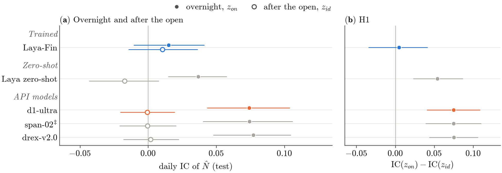
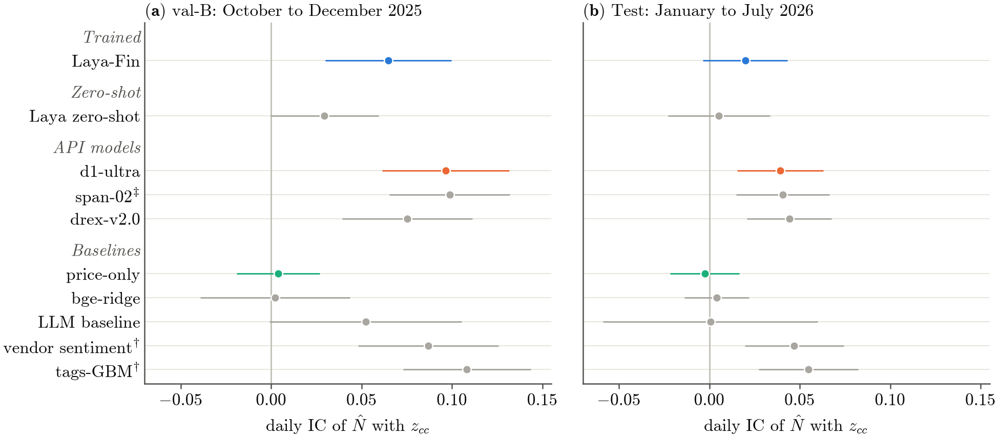
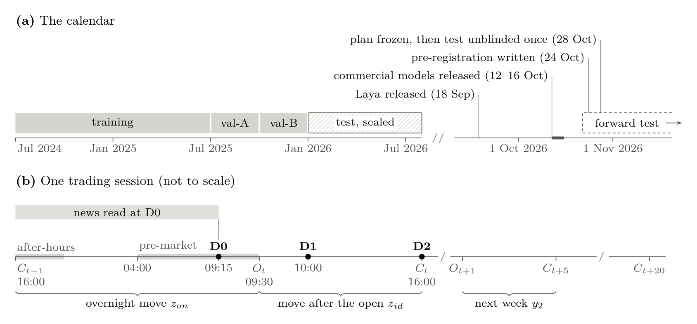

<div align="center">

# NewsAction

### Thinking Fast, Trading Late: System One Decision Models vs the Market

Amir Dehkordi · Alireza Kargarzadeh · Nariman Khaledian · Navid Parvini · Sid Ghatak · Arman Khaledian

[](https://arxiv.org/abs/2611.03985)
[](https://doi.org/10.48550/arXiv.2611.03985)
[](docs/PREREG.md)
[](LICENSE)
[](pyproject.toml)

**[Paper](https://arxiv.org/abs/2611.03985)** · **[PDF](artifacts/NA-16/paper.pdf)** ·
**[Pre-registration](docs/PREREG.md)** · **[Reproduce](#reproduce-the-paper)** · **[Cite](#citation)**

</div>

This repository is the paper's replication package. It holds the pre-registration and its deviations log, the code
of every stage with its tests, every committed output, the audit ledgers and the sources of the paper.

> Large language models read company news at scale, and backtests suggest that their readings predict stock
> returns. We ask how much of that predictability survives a test that rules out look-ahead, memorization and
> selection. Under a pre-registered, blinded protocol, the commercial models' readings of pre-open news line up with
> the overnight move to the open, not with the move after it: the news is priced by the time a trader can act on
> it. A fine-tuned model's validated signal fell on the blinded test, no model can tell over- from under-reaction,
> and no pre-registered strategy survives costs. **The market reads the news first.**

<p align="center">
  
</p>

<sub><b>Pre-open news is priced at the open</b> (the paper's Figure 3). Daily information coefficient (IC) of each
model's pre-open reading on the blinded January to July 2026 test, with (a) the overnight move, from the previous
close to the open, and (b) the move after the open, from the open to the close; (c) is their difference, hypothesis
H1. 95% bootstrap intervals. The API models failed the pre-registered contamination screens, so their results are
specific to those models. ‡ span-02: a canary check fired a STOP after the freeze and the operator chose to proceed
(PREREG §15).</sub>

## Key findings

1. **Pre-open news is priced at the open.** The commercial models' readings line up with the overnight move from
   the previous close to the open (daily IC 0.074 to 0.077) but not with the move after the open (about zero). No
   model predicts the move after the open, which is the part a trader who reads the news before the open can still
   earn.
2. **A validated signal did not survive the blinded test.** Laya-Fin, the model we fine-tuned, had a daily IC of
   0.055 and 0.065 (t = 3.6) on the two validation quarters and 0.020 (t = 1.7) on the test. Every model whose
   validation IC was clearly positive fell, none of the five primary hypotheses is supported, and no pre-registered
   strategy survives costs and a deflated Sharpe ratio.
3. **The models cannot judge the reaction.** In the pre-registered over/under-reaction regression the news
   coefficient is not positive (Laya-Fin b = −0.044, p = 0.62), and the moves the models call underreactions never
   catch up. Out of sample, same-day news explains 0.25% (Laya-Fin) to 0.82% (d1-ultra) of a stock's own daily
   variance.
4. **Masking is not anonymity.** Given masked news, the commercial models pick the company out of four same-sector
   candidates in 62% to 74% of cases, against a matched baseline of 28%; the open-weights Laya model does so in 32%.

<p align="center">
  
</p>

<sub><b>Every validation IC that was clearly positive fell on the blinded test</b> (the paper's Figure 2). Daily IC
of each model's pre-open reading with the close-to-close move on (a) val-B, October to December 2025, and (b) the
test, January to July 2026, with 95% intervals. † The vendor-label baselines use labels the vendor produced after
the fact: an upper bound that may carry look-ahead, not a benchmark.</sub>

## The study

A **decision model** is a non-generative language model. It takes a *state* (text plus structured context) and a
set of typed questions (a choice among options, a score on an ordered scale, or a yes-or-no question) and returns
probabilities over the answers instead of generating text. For each S&P 500 company (point-in-time membership) and
each trading session from July 2024 to July 2026, we build the news state as of 09:15 ET, mask the company's
identity (names, tickers, people, dates and every mention of a price move) and ask two questions:

- **Before the open** (D0, 09:15 ET), the *pre-open reading*: how will the stock perform once the news is absorbed?
- **Once part of the reaction is visible** (D1 at 10:00 ET, D2 after the close), the *post-reaction reading*: was
  the reaction so far too small or too large for the news?

<!-- docs/assets/design.png is the paper's Figure 1, cropped from artifacts/NA-16/paper.pdf (page 7) at 250 dpi. -->
<p align="center">
  
</p>

<sub><b>The design</b> (the paper's Figure 1). (a) Every choice was made on 2025 validation data, the 2026 test was
sealed until the plan was frozen, and every model was released after the sample ended. (b) One trading session; the
overnight move runs from the previous close to the open, so it includes after-hours and pre-market trading.</sub>

| Period | Dates | Used for |
|---|---|---|
| Training | 2024-07-01 to 2025-06-30 | Fine-tuning Laya-Fin; fitting the baselines |
| val-A | 2025-07-01 to 2025-09-30 | The model tournament, the encoding search, calibration |
| val-B | 2025-10-01 to 2025-12-31 | Confirmation and the final selection |
| Test | 2026-01-02 to 2026-07-31 | Sealed until the plan was frozen on 2026-10-28, then unblinded once |
| Forward test | News from 2026-10-22 on | Pre-registered on 2026-10-29, after every model's release; not yet run |

**The models.** The primary instrument, **Laya-Fin**, is [Laya](https://huggingface.co/convaiinnovations/laya), an
open-weights decision model built on ModernBERT-large, fine-tuned once on the training period on Kaggle's free GPUs.
Every eligible decision model in OpenRouter's catalog entered a zero-shot tournament on val-A. The six with the
highest first-stage IC faced four pre-registered contamination screens and none passed; the three with the highest second-stage
IC, **d1-ultra**, **span-02** and **drex-v2.0**, were carried to the test as screen-failing comparators. They are
compared with the untuned Laya model, a ModernBERT anchor fine-tuned the same way (its outputs are nearly constant,
so it is reported as uninformative) and five baselines: a ridge regression on news embeddings, a price-only model, a
generative LLM whose stated knowledge cutoff precedes the sample, and two models on the vendor's labels.

## The OLIVIA protocol

The design implements OLIVIA, a protocol of six safeguards for testing language-model signals on financial news
without look-ahead; the initials of the six safeguards give the name. The paper's Table 1 lists them as a checklist
that other studies can adopt. In this repository every safeguard is code, and every guard has a test that fails
when the guard is removed.

| Safeguard | Guards against | Where it lives |
|---|---|---|
| **O**ne-time unblinding | Repeated looks at the test period | The 2026 prices are sealed and read only through [`lock.py`](src/newsaction/lock.py), which checks the frozen hash; every read is appended to [`ledgers/test_access.jsonl`](ledgers/test_access.jsonl) (29 in all) |
| **L**ook-ahead-free states | Inputs that were not public at the decision | The exchange calendar ([`calendar.py`](src/newsaction/calendar.py)), availability times ([`timeutil.py`](src/newsaction/timeutil.py)) and an availability registry ([`pit.py`](src/newsaction/pit.py), [`configs/availability.yaml`](configs/availability.yaml)) that makes a state builder fail on any input known only after the decision |
| **I**dentity masking | A model recalling what happened to a company it recognizes | The masker ([`states/mask.py`](src/newsaction/states/mask.py)), an independent leak scanner ([`states/scan.py`](src/newsaction/states/scan.py)), numbers as words ([`configs/codebook_v1.yaml`](configs/codebook_v1.yaml)) and a matched-distractor recognition test |
| **V**alidation-only selection | Choosing models, filters or thresholds on the test | Search and calibration on val-A ([`tournament/`](src/newsaction/tournament), [`encoding/`](src/newsaction/encoding)); val-B opens only through the `allow_val_b` gate in [`configs/frozen.yaml`](configs/frozen.yaml), which the decision-model client ([`dm/client.py`](src/newsaction/dm/client.py)) enforces |
| **I**mmutable plan | Changing hypotheses or tests after seeing results | [`docs/PREREG.md`](docs/PREREG.md), the configs and the target code, frozen by SHA-256 ([`freeze.json`](artifacts/NA-11/freeze.json), git tag `prereg-freeze`) before any test-period call; later changes go only to the dated, append-only deviations log (PREREG §15) |
| **A**udit trail | Unreported variants | Append-only, hash-chained [`ledgers/`](ledgers) of every evaluated variant (their count sets the bar of the deflated Sharpe ratio), API spend, test-data access and FMP data requests; `make ledgers` verifies the chains |

## What's in this repository

```text
paper/                 the paper's LaTeX; every result number is a \res{} macro generated from artifacts/NA-14
artifacts/NA-xx/       each stage's committed outputs: REPORT.md, tables, results, figure data
  NA-14/               the paper's tables and figures, each figure with the CSV of its plotted values
  NA-16/               the paper PDF and the arXiv source bundle
docs/PREREG.md         the pre-registration, its amendments and the full deviations log
docs/REPLICATION.md    how to rebuild the paper, the expected digests, the resources used
docs/DATA_CONTRACT.md  the schema and sha256 of every derived file
docs/decisions/        each stage's decisions and findings
src/newsaction/        the pipeline: point-in-time guards, prices, news, events, states, the decision-model
                       client, model selection, training, baselines, analysis, strategies, figures, paper build
configs/               every constant, split, question and threshold (covered by the freeze hash)
ledgers/               append-only, hash-chained JSONL: trials, spend (Git LFS), test access, FMP requests
tests/                 1,100+ tests; every guard has one that fails when the guard is removed
scripts/               command-line tools for the data stages
arxiv/                 the arXiv abstract and submission metadata
NewsAction PRD.md      the work plan: the power and verification prompts of NA-00 to NA-15
CLAUDE.md              the rules every session followed
CITATION.cff           citation metadata (GitHub's "Cite this repository")
```

> [!NOTE]
> **The data are not included.** The news text is licensed and is not redistributed, and neither are the price
> data or the index membership. These stay on the operator's machine: `Data/` (raw news, prices and market files),
> `work/` (derived data), `cache/` (decision-model responses), `.env` (API keys) and the files that hold news text:
> `artifacts/NA-02/{spam_judgments,detector_eval}.csv`, `artifacts/NA-04/examples.md` and
> `artifacts/NA-05/canary_v1.jsonl` (their tests skip without them).

## Reproduce the paper

The paper's tables, figures, numbers and PDF rebuild on a fresh clone, without the data, an API key or a GPU.

```bash
brew install git-lfs tectonic && git lfs install   # once per machine; ledgers/spend.jsonl (over 200 MB) is in Git LFS
git clone https://github.com/AmirDehkordi/NewsAction.git && cd NewsAction
uv sync --locked --all-extras                      # Python 3.12 with uv; the extras (spacy, torch) are needed for `make type`

make test        # the test suite; tests that need work/ skip
make ledgers     # verify the hash chain of every ledger
make paper       # rebuild every table, figure and caption from the committed outputs (~10 s) and check their digests
make paper-pdf   # write the number macros and compile the manuscript to artifacts/NA-16/paper.pdf
```

`make paper` alone needs only the core dependencies (`uv sync --locked`). Two of its tables, t26 and t33, are built
from NA-13's position-level books, which derive from the licensed prices: on a clone they are carried over as
committed, and every other output must match its committed digest. [`docs/REPLICATION.md`](docs/REPLICATION.md)
traces every number to its source and lists the expected digests.

| Runs on a clone | Needs the data (the operator's machine) |
|---|---|
| `make lint`, `make type`, `make test`, `make ledgers` | `make manifest` and `make verify`, which check `work/` and `Data/` |
| `make paper`, `make paper-text`, `make paper-pdf` | `python -m newsaction.figures.paper --write-digests` (recording new digests needs every input) |
| `make paper-arxiv`, `make paper-arxiv-check` (the arXiv bundle compiled with pdflatex in Docker's TeX Live 2023, as arXiv compiles it) | Any stage run and any decision-model API call |

## How the study was built

The study is organized in 18 stages ("chunks"). The work plan, [`NewsAction PRD.md`](NewsAction%20PRD.md), gives
each planned chunk (NA-00 to NA-15) a **power prompt**, which builds and runs it in a fresh AI coding session, and a
**verification prompt**, which checks it in a separate, independent session: one that is read-only, works from the
response cache, spends nothing and mutates each guard to confirm that its test fails. NA-13b and NA-16 were added
along the way. Each chunk that has run has its own branch, report and decision log, and
[`CLAUDE.md`](CLAUDE.md) holds the rules every session followed. In the paper's words: "An AI coding and
research assistant (Claude, by Anthropic, used through Claude Code) implemented and ran the pre-registered pipeline
under the authors' direction and drafted this manuscript from the verified outputs. The authors take full
responsibility for the content."

| Stage | What it did |
|---|---|
| [NA-00](artifacts/NA-00/REPORT.md) | Repository scaffold; time, blinding and ledger primitives; pre-registration v0 |
| [NA-01](artifacts/NA-01/REPORT.md) | Point-in-time S&P 500 universe, adjusted daily panel and size tiers; 2026 prices sealed |
| [NA-02](artifacts/NA-02/REPORT.md) | News timing audit, symbol mapping, cleaning, re-embedding and point-in-time novelty |
| [NA-03](artifacts/NA-03/REPORT.md) | Importance filters, the material label and events |
| [NA-04](artifacts/NA-04/REPORT.md) | Model states: context, the numbers-as-words codebook, masking and the question battery |
| [NA-05](artifacts/NA-05/REPORT.md) | The decision-model client: cache, budget guard, model catalog, canary set, local Laya and a pilot |
| [NA-06](artifacts/NA-06/REPORT.md) | Zero-shot decision-model tournament and contamination probes |
| [NA-07](artifacts/NA-07/REPORT.md) | Encoding ("numbers as words") and anchoring study |
| [NA-08](artifacts/NA-08/REPORT.md) | Laya-Fin and the ModernBERT anchor, trained on Kaggle's free 2×T4 GPUs |
| [NA-09](artifacts/NA-09/REPORT.md) | Baselines, including a generative LLM at matched cost |
| [NA-10](artifacts/NA-10/REPORT.md) | 30-minute bars for the 10:00 decision; the 2026 bars sealed |
| [NA-11](artifacts/NA-11/REPORT.md) | Final selection on val-B, the analysis spec, **the freeze**, production runs and ablations |
| [NA-12](artifacts/NA-12/REPORT.md) | Unblinding, once, and the pre-registered analyses |
| [NA-13](artifacts/NA-13/REPORT.md) | Strategies and economic significance |
| [NA-13b](artifacts/NA-13b/REPORT.md) | When does the signal work? (exploratory, post hoc) |
| [NA-14](artifacts/NA-14/REPORT.md) | The paper's figures and tables and the replication build |
| NA-15 | Forward test on news published after the models' release: pre-registered, not yet run |
| [NA-16](artifacts/NA-16/REPORT.md) | The manuscript and the arXiv source bundle |

The whole study used:

| Resource | Used | Cap |
|---|---|---|
| Decision-model API calls (OpenRouter) | $15.73 | $30 |
| GPU time (Kaggle's free 2×T4) | 25.38 GPU-hours | 30 hours a week |
| 30-minute price bars (FMP) | 15,858 requests | 17,000 |
| Evaluated variants, every one logged | 1,620 | |
| Accesses to test-period data, every one logged | 29 | |

## For contributors

<details>
<summary><b>Setup on the operator's machine (with the data)</b></summary>

Python 3.12 and [uv](https://docs.astral.sh/uv/). `Data/` (raw, read-only, gitignored) must sit at the repository
root; see `Data/README.md`.

```bash
make sync                                  # uv sync --locked (runtime + dev tools)
cp .env.example .env                       # only the keys the current chunk needs; never commit .env
uv run python scripts/convert_pickles.py   # NA-00: rebuild work/market/*.parquet from Data/market
make verify
```

Optional dependency groups are declared but not installed by `make sync`: `uv sync --extra embed` (NA-02),
`--extra laya` (NA-05), `--extra kaggle` (NA-08). `make sync` is an exact sync and removes them again; use
`uv sync --locked --all-extras` to keep them.

</details>

<details>
<summary><b>Running a chunk</b></summary>

1. Start from an up-to-date `main` and a **fresh** Claude Code session in this directory.
2. Paste the chunk's *Power prompt* from the PRD. It works on branch `feat/NA-xx-<slug>`, commits there
   (Conventional Commits) and ends with a self-audit in `artifacts/NA-xx/REPORT.md`.
3. In **another fresh session**, paste the chunk's *Verification prompt*. Verifiers are read-only, restore any
   mutation they make and spend nothing.
4. The operator merges the branch into `main` only after the verifier's PASS.

</details>

<details>
<summary><b>Making changes</b></summary>

- Work on a branch (`feat/<topic>` or `fix/<topic>`) and open a pull request into `main`. The operator merges.
- Never edit or append to `ledgers/*.jsonl` by hand. They are hash-chained and written only by the operator's runs.
- After the NA-11 freeze, `docs/PREREG.md`, `configs/` and the analysis spec and targets code do not change. A
  deviation is appended to the PREREG §15 log (CLAUDE.md rule 11).
- To edit the paper, change `paper/sections/*.tex`. Every result number is a `\res{name}` macro, defined in
  `paper/numbers.yaml` and generated from `artifacts/NA-14`; do not type result numbers by hand.
- The history was rewritten for the upload on 2026-10-30. Commit hashes cited in older documents and in the ledgers'
  `git_sha` fields are the pre-upload ones; `docs/COMMIT_MAP.tsv` maps them to the current commits.

</details>

<details>
<summary><b>Make targets</b></summary>

| Target | What it does |
|---|---|
| `make sync` | `uv sync --locked` |
| `make lint` | `ruff check` + `ruff format --check` on `src/`, `tests/`, `scripts/` |
| `make format` | apply `ruff format` and safe `ruff check --fix` |
| `make type` | `mypy --strict src/` |
| `make test` | `pytest -q -m "not network"` (warnings are errors) |
| `make manifest` | re-hash every artifact in `work/MANIFEST.json`, check `Data/` inputs (size + mtime), flag unregistered parquet files, compare each sha256 with `docs/DATA_CONTRACT.md` |
| `make manifest-deep` | as `manifest`, and re-hash every `Data/` input |
| `make ledgers` | verify the hash chain of every `ledgers/*.jsonl` |
| `make verify` | lint + type + test + manifest + ledgers |
| `make paper` | NA-14: rebuild every paper table, figure and caption offline and compare the committed digests |
| `make paper-preview` | NA-14: compile `artifacts/NA-14/paper_preview.tex` with tectonic and check it |
| `make paper-text` / `make paper-pdf` | NA-16: the manuscript's number macros and checks / the PDF (tectonic) |
| `make paper-arxiv` / `make paper-arxiv-check` | NA-16: the arXiv source bundle / its pdflatex compile (Docker) |

</details>

<details>
<summary><b>Guards (<code>src/newsaction/</code>)</b></summary>

| Module | Guard |
|---|---|
| `calendar` | XNYS sessions, open/close instants (half days, DST) and the decision windows W0 = (close(prev), 09:15 ET], W2 = (close(prev), close]; scalar and vectorized `session_of_w0/w2` (PREREG §2.4) |
| `timeutil` | timestamp precision class and availability time t_avail (PREREG §2.2–2.3) |
| `pit` | availability registry (`configs/availability.yaml`): `check_inputs(columns, "D0"/"D1"/"D2")`, `assert_visible` |
| `lock` | blinding of 2026 data: `sealed_path` / `read_sealed` (logged in `ledgers/test_access.jsonl`), `freeze` (NA-11), `require_unblind` (NA-12) |
| `ledger` | append-only, hash-chained ledgers: spend with hard caps (PREREG §13), trials, test access, FMP requests |
| `io` | hashed parquet I/O, `work/MANIFEST.json`, fingerprints of every `Data/` input read; `register_artifact` for committed outputs under `artifacts/` |
| `dm.client` | the only path to a decision model (OpenRouter Decisions API or local Laya): refusals (third-party, test period before the freeze, val-B gate, unmasked states, eligibility, `:free`), the sha256 response cache (`cache/decisions.sqlite`), dry runs and the spend ledger with hard caps, retries, `data_collection: deny`, offline mode for verifiers (CLAUDE.md C12–C14); `chat_json` (NA-09) sends chat completions with a strict JSON schema through the same refusals, cache, budget and offline mode, to `frozen.yaml` `chat_models` only |
| `tournament` | PREREG §8.2–8.3 model selection on val-A only: nested seeded samples without the embargo, the Model Confidence Set (stationary bootstrap over days), mechanical screens whose thresholds come from `configs/tournament.yaml` (= PREREG §8.3), rule-based counterfactual edits; `allow_val_b` is set only after every NA-06 call (CLAUDE.md B9, C13) |
| `encoding` | PREREG §8.4 encoding and anchoring rules: search on val-A only, val-B read only for the confirmation check and only when the val-A best is not E3 (`run.targets` refuses otherwise); thresholds from `configs/encoding.yaml` (= PREREG §8.4, parsed from its text by the tests); the numeracy probe is outcome-free (synthetic reaction blocks) |
| `baselines` | PREREG §10 baselines in one validated prediction schema: fit on train only and tuned on val-A only (fit records checked before anything is written), inputs checked with the availability registry (vendor fields only as the pre-registered signals), metrics on val-A only, no D2 or price-only test prediction before the freeze (CLAUDE.md A5–A6, B8–B9) |

Each guard has tests that fail when the guard is removed (`tests/`).

</details>

## Citation

If you use this code or the OLIVIA protocol, please cite the paper:

```bibtex
@misc{dehkordi2026thinking,
  title         = {Thinking Fast, Trading Late: System One Decision Models vs the Market},
  author        = {Dehkordi, Amir and Kargarzadeh, Alireza and Khaledian, Nariman and Parvini, Navid and
                   Ghatak, Sid and Khaledian, Arman},
  year          = {2026},
  eprint        = {2611.03985},
  archivePrefix = {arXiv},
  primaryClass  = {cs.AI},
  doi           = {10.48550/arXiv.2611.03985},
  url           = {https://arxiv.org/abs/2611.03985}
}
```

GitHub's "Cite this repository" button reads the same metadata from [`CITATION.cff`](CITATION.cff).

## License, data and acknowledgments

- **Code:** MIT ([`LICENSE`](LICENSE)).
- **Data:** private and not part of this package. The news text is licensed and is not redistributed, and neither
  are the price data or the index membership.
- **Acknowledgments:** the NewsWitch news corpus was provided by Zanista AI Ltd, and the cleaned dataset was
  prepared at TailState Intelligence Ltd. The paper's closing statements give its funding, competing interests and
  use of AI tools. It builds on the earlier study by five of its authors,
  [Buy the Rumor, Sell the News: When Is News Priced In?](https://arxiv.org/abs/2608.14014) (AI4F 2026).
- **Contact:** [open an issue](https://github.com/AmirDehkordi/NewsAction/issues) or write to the corresponding
  author, Amir Dehkordi (amir.dehkordi98@gmail.com).
